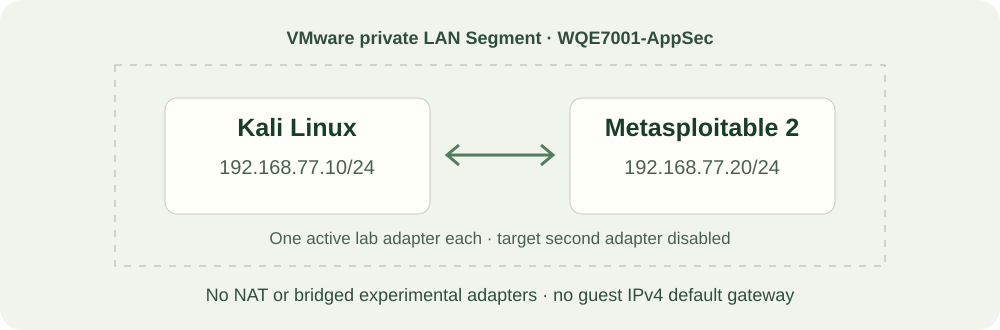

# Isolated virtual lab setup

**Focus:** networking, Linux and safe test scope  
**Environment:** VMware Workstation, Kali Linux and Metasploitable 2  
**Evidence:** course lab records refreshed on 4 November 2026

## Objective

Build a small lab in which a test workstation can reach a deliberately vulnerable target without giving the guests an ordinary route to the home network or internet. This project documents the environment and isolation checks. The [Nmap project](../nmap-service-scan/) uses the same lab for a different task: service discovery and interpretation.

## Environment

| Component | Recorded configuration |
|---|---|
| Hypervisor | VMware Workstation |
| Network | Private LAN Segment `WQE7001-AppSec` |
| Test workstation | Kali Linux, `192.168.77.10/24` |
| Vulnerable target | Metasploitable 2, `192.168.77.20/24` |
| Active test interfaces | One on each guest; the target's unused second adapter disabled |
| Experimental adapters | Neither NAT nor bridged networking |
| Guest IPv4 routing | Local subnet routes; no default gateway in the recorded output |

The addresses are private lab addresses. Metasploitable is intentionally insecure and must stay inside the controlled training environment.



## Method

1. Use the existing VMware installation and two owned or controlled guests. Select the same private LAN Segment on each guest.
2. Check every guest adapter. Keep one active test interface per guest, disable the target's unused adapter, and confirm that the test adapters are not using NAT or bridged networking.
3. Assign the lab addresses above. Check the guest identity and address before treating later output as evidence from the correct machine.
4. Inspect IPv4 routes on both guests. On Kali, use `ip -4 route`; the older target requires `route -n`. Confirm the local subnet and the absence of an IPv4 default gateway.
5. Run a three-packet ping from each guest to the other. Keep the output rather than relying on a network-settings label alone.
6. On Kali, run `ip -4 route get 1.1.1.1`. This queries the local routing table. It is not an external scan, and the recorded result was `Network is unreachable`.
7. Read the available IPv6 output in context. The target's rejected `::/0` entries on `lo` are not a usable external default route. Retain the displayed guest dates rather than changing them to match a capture date.

Example checks for the Kali guest:

```bash
hostname
ip -br addr
ip -4 route
ip -6 route
ip -4 route get 1.1.1.1
ping -c 3 192.168.77.20
```

Compatible checks for the older Metasploitable guest:

```bash
hostname
ifconfig -a
route -n
route -A inet6 -n
ping -c 3 192.168.77.10
```

## Results and evidence

- Both directions recorded three transmitted and three received packets, with zero loss.
- Kali had the local `192.168.77.0/24` route and no usable external route for the lookup above.
- The native target console shows its address, local IPv4 route and reverse ping.
- The recorded adapter and route checks support ordinary external-network isolation in this configuration. They do not prove protection against every possible hypervisor or IPv6 escape.

| Evidence | Collection method |
|---|---|
| [Target identity and address](evidence/target-identity.png) | Learner-supplied native console retake |
| [Target routes and reverse ping](evidence/target-routes-and-ping.png) | Learner-supplied native console retake |
| [Kali routes and forward ping](evidence/kali-isolation-checks.png) | Assistant-operated live checks, 4 November; original on-screen label retained |
| [Configuration record](evidence/lab-configuration.md) | Selected, non-sensitive configuration details from the recorded lab; no VMX file or host filesystem path published |
| [Evidence manifest](evidence/manifest.json) | File hashes and collection notes |

## Troubleshooting

The target's old `ip` command did not support `ip -br addr`. The console returned an unknown-option message. Using `ifconfig -a` and `route -n` supplied compatible address and route evidence. This was a command-version issue, not proof that the network interface had failed.

Guest clocks also differed. I keep their original readings and distinguish them from the evidence-refresh date. A timestamp printed in a guest is not automatically the host capture time.

## What I would improve

For another run, I would use a short checklist before starting either guest: intended target, adapters, routes and snapshot state. I would also collect matching full IPv4 and IPv6 route outputs on both guests during one session. A failed external ping alone would not be enough to establish isolation.

For AppSec work, this environment gives me a controlled place to investigate requests and services. A later project should connect a security issue to a code change and a verified repair.

## Contribution and scope

Codex assisted with the initial setup on 31 October 2026. On 2 November, Gong Bingyan confirmed personal reproduction and understanding of the isolation checks and scan. During the 4 November refresh, the learner supplied native target-console retakes; Codex operated the Kali check. These roles are retained in the evidence descriptions. This portfolio does not present every supplied image as an independently captured student screenshot.

## References

- [Rapid7: Metasploitable 2](https://docs.rapid7.com/metasploit/metasploitable-2/)
- [NIST SP 800-115: Technical Guide to Information Security Testing and Assessment](https://doi.org/10.6028/NIST.SP.800-115)

[Read the web version](index.html) · [Return to the portfolio](../../index.html#projects)
